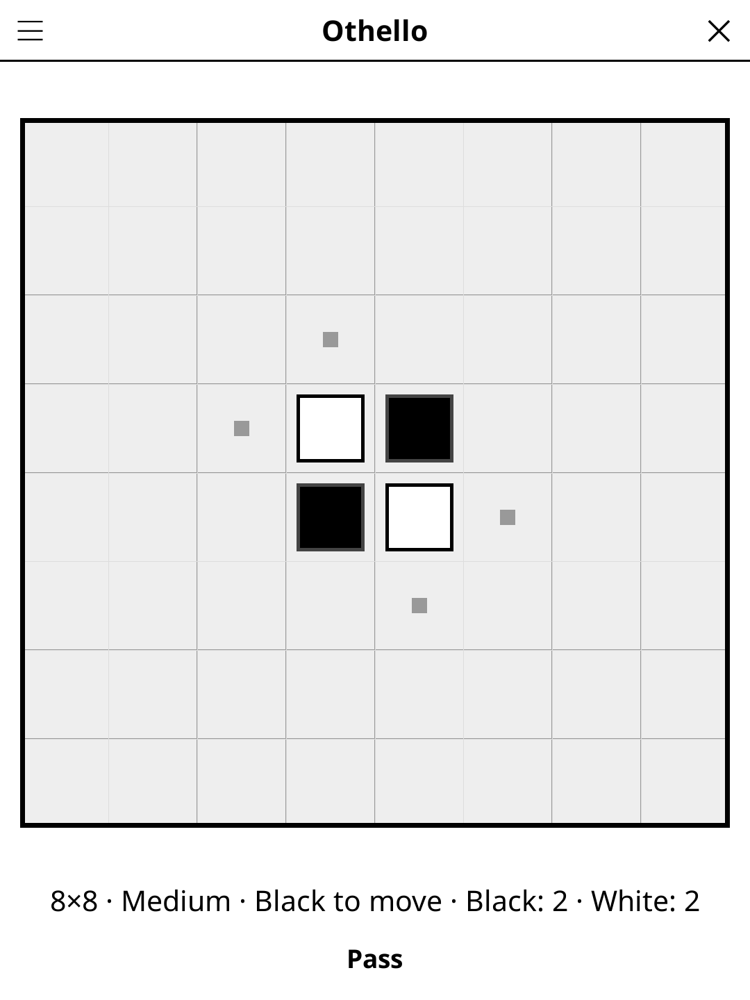

# othello.koplugin

An Othello (Reversi) plugin for [KOReader](https://github.com/koreader/koreader).

## Screenshot

## Rules

Place a disc to flip all straight lines of opponent discs between your new disc and an existing one of yours. You must flip at least one disc per move. If no valid move exists, your turn is skipped. Most discs of your colour when the board is full wins.

## Features

- **Two-player local mode**
- **Valid move highlight** — shows all legal placements
- **Disc count** — live score for both players
- **Undo** — take back the last move
- **Auto-save** — game state saved and restored on next launch
- **AI opponent, three levels** — Easy looks two moves ahead and often picks a weaker move, Medium looks four moves ahead with a little variety, Hard looks six moves ahead (at most ~2 s per move on an e-reader); Easy and Medium do not play the same game twice
- **Exact endgame** — on Medium and Hard, with 10 or fewer squares left the AI plays the position out to the last disc, so its finish is proven rather than estimated

## Installation

1. Download `othello.koplugin.zip` from the [latest release](../../releases/latest).
2. Extract into the `plugins/` folder of your KOReader data directory.
3. Restart KOReader.
4. Open the menu → **Tools** → **Othello**.

## Controls

| Action | How |
|--------|-----|
| Place a disc | Tap a valid cell |
| Undo last move | Tap **Undo** |
| New game | Tap **New game** |
| Show rules | Tap **Rules** |

## License

GPL-3.0 — see [LICENSE](LICENSE).
